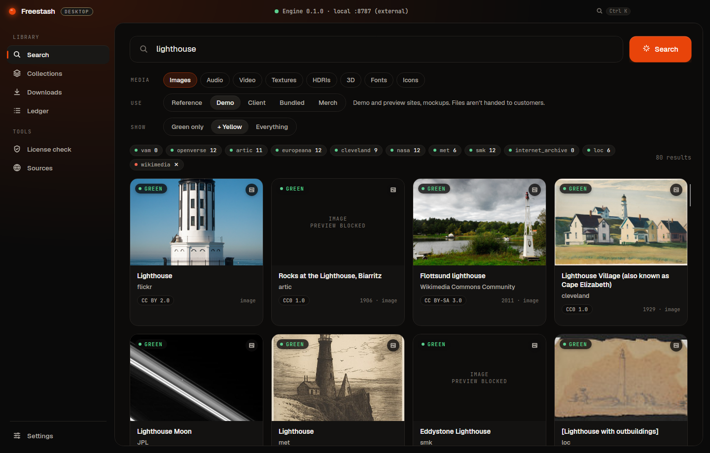
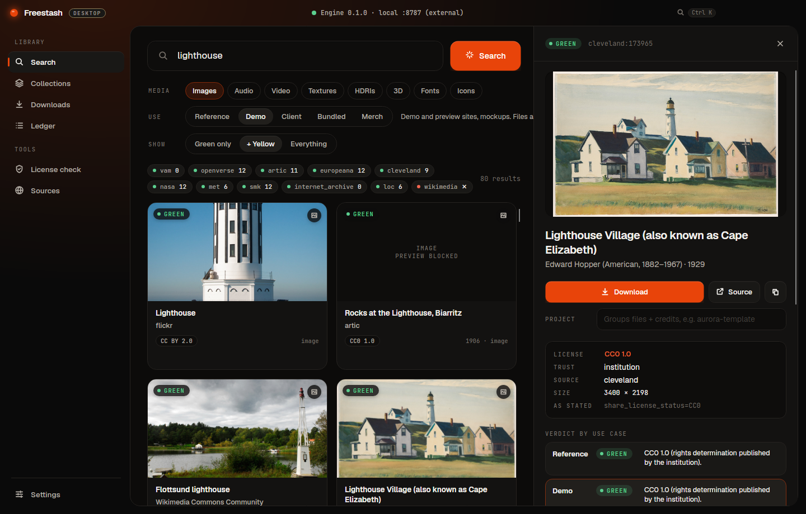
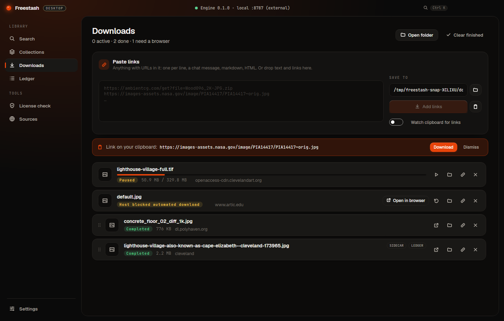
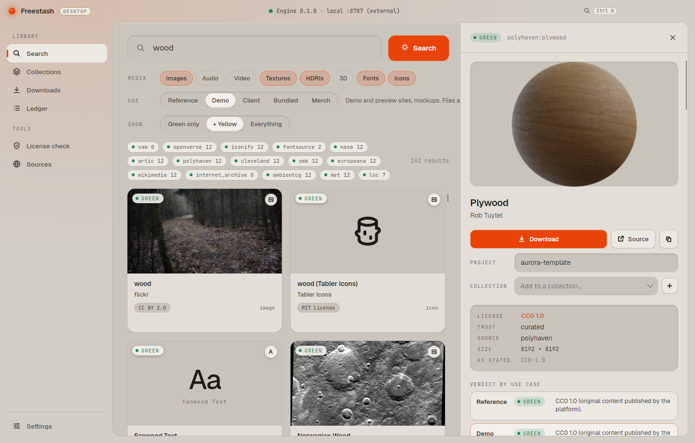
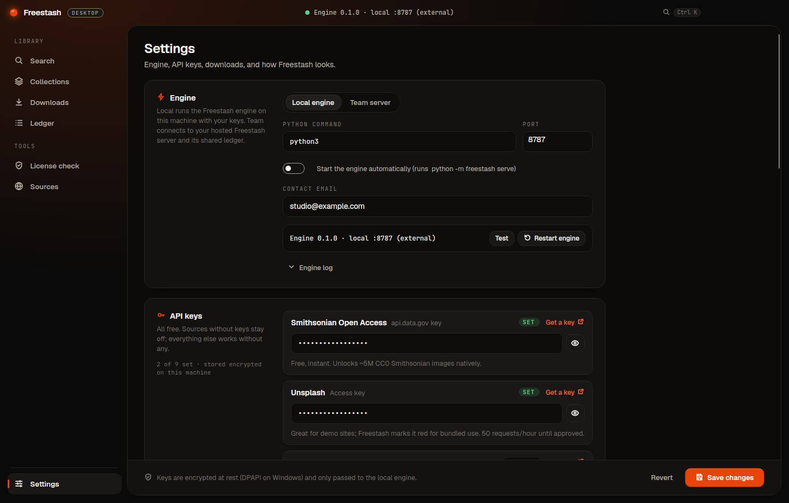

# Freestash Desktop · [freesta.sh](https://freesta.sh)

The native desktop app for **Freestash**: one search across ~20 open sources (museums, NASA, Library of Congress,
Openverse, Wikimedia, Poly Haven, ambientCG, Fontsource, Iconify, Unsplash/Pexels/Pixabay with keys…) with every
result scored **green / yellow / red for what you're actually going to do with it**.



**What the desktop app adds over the web UI**
- A real download manager: paste or drop any text with links, pick a folder, pause/resume/retry, clipboard watcher.
  Hosts that block automated downloads get an **Open in browser** button instead of a mystery failure.
- Every Freestash download gets a `.license.json` sidecar + SHA-256 + a ledger entry. **Drag finished files** straight
  into Explorer, a DAW, or Figma, and the sidecar comes along.
- **Settings vault** for API keys, encrypted at rest (DPAPI on Windows). The app runs the local Freestash engine with them.
- Two looks: **Ember Dark** and **Machined Light**, with four accents, switchable live.

## Run

```bash
# 1. the engine (sister repo)
cd ../freestash && python -m pip install -e ".[all]"
# 2. the app (auto-starts `python -m freestash serve`)
dotnet run --project src/Freestash.Desktop
```

Requires the .NET 10 SDK. See `CLAUDE.md` for architecture and `IMPLEMENTATION.md` for what's next.

| | |
|---|---|
|  |  |
|  |  |
